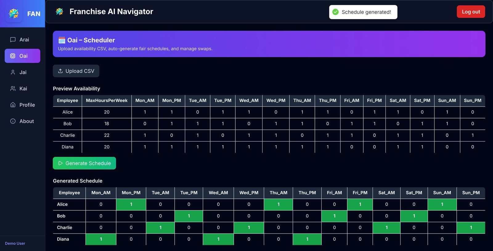
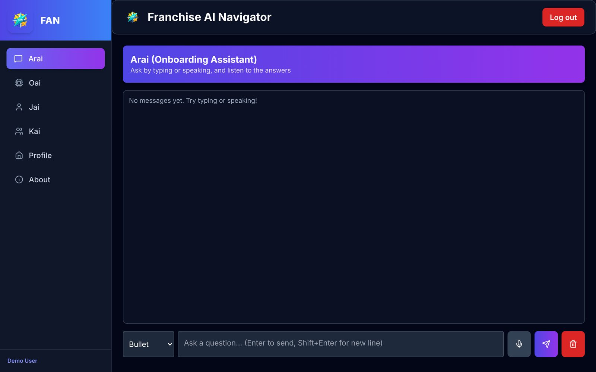
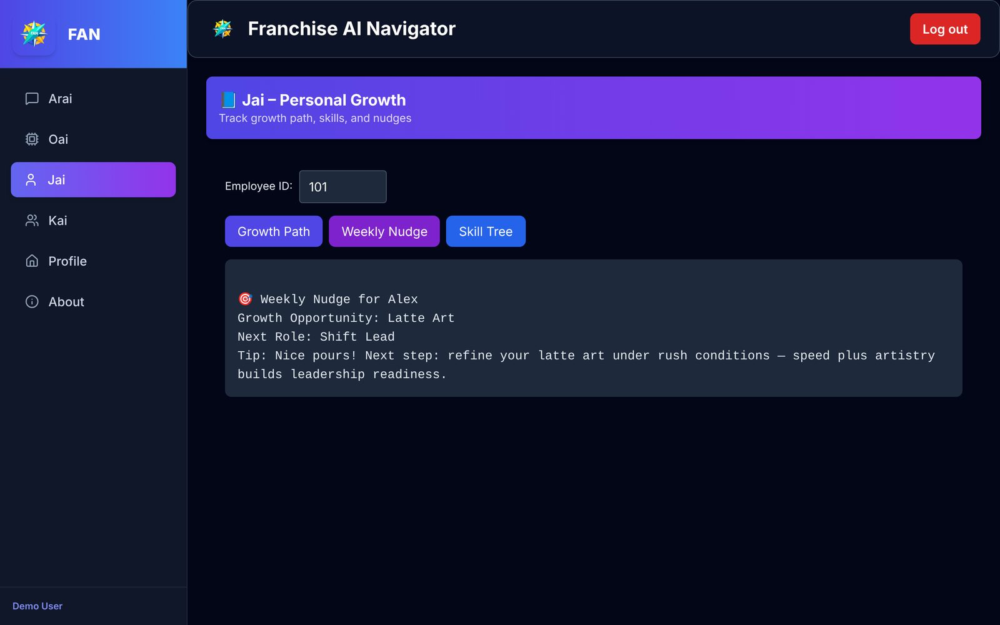
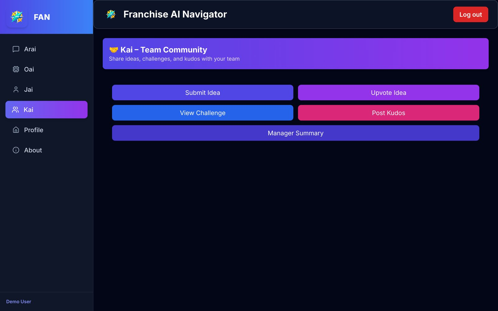
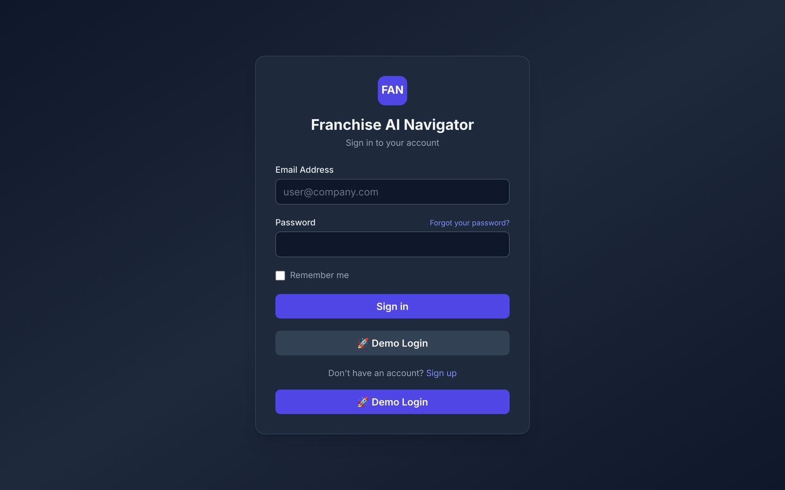

# FAN — Franchise AI Navigator (Frontend)

Web app for **FAN**, a set of AI agents that help franchise staff from onboarding to
promotion. Built for the **SAP AI Hackathon 2025** by Jiratip J. and Krittaphas T.

This repo is the Next.js UI; the API and agents live in
[**fan-backend**](https://github.com/classy-j/fan-backend).



## Features

| Tab | Agent | What you can do |
| --- | --- | --- |
| **Arai** | Onboarding Q&A | Chat with the training manual. Answers come only from the manual (RAG) and show the source section. |
| **Oai** | Scheduling | Upload staff availability as CSV, generate a fair weekly schedule, swap shifts, export the result. |
| **Jai** | Growth | Look up an employee's next role, required skills, and a weekly growth nudge. |
| **Kai** | Engagement | Submit and upvote ideas, see the current team challenge, send kudos. |

<table>
  <tr>
    <td></td>
    <td></td>
  </tr>
  <tr>
    <td></td>
    <td></td>
  </tr>
</table>

## Getting started

Requires Node.js 18+ and a running [fan-backend](https://github.com/classy-j/fan-backend).

```bash
npm install
cp .env.example .env.local      # set NEXT_PUBLIC_API_URL if the backend isn't on :8000
npm run dev                     # http://localhost:3000
```

A sample availability file for the Oai tab is in the backend repo at
`data/samples/availability.csv`.

> The login page is a demo screen: any email and password will sign you in.

## Project structure

```text
pages/        Routes: intro, login, app
components/   One component per tab (AraiTab, OaiTab, JaiTab, KaiTab, ...) plus layout
utils/api.ts  Backend URL (from NEXT_PUBLIC_API_URL)
styles/       Tailwind globals
public/       Logo and intro video
```

## Tech stack

Next.js 13 · React 18 · TypeScript · Tailwind CSS · Framer Motion · Lucide icons
